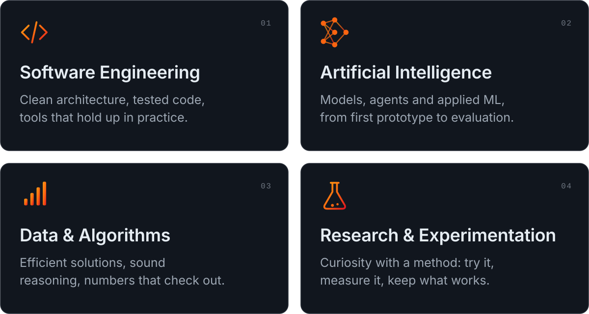

<!-- Quemando Tokens · perfil de la organización · recursos gráficos en ./assets (SVG animados, hechos a mano) -->

<a href="#quiénes-somos">Quiénes somos</a> &nbsp;·&nbsp; <a href="#el-equipo">El equipo</a> &nbsp;·&nbsp; <a href="#logros">Logros</a> &nbsp;·&nbsp; <a href="#en-qué-trabajamos">En qué trabajamos</a> &nbsp;·&nbsp; <a href="#cómo-trabajamos">Cómo trabajamos</a> &nbsp;·&nbsp; <a href="#ahora">Ahora</a> &nbsp;·&nbsp; <a href="#proyectos">Proyectos</a>

### Quiénes somos

**Cuatro estudiantes de ingeniería en Bilbao a quienes nos gustan los problemas difíciles.**

Estudiamos en la Universidad de Deusto y construimos juntos: software, inteligencia artificial y alguna idea que parece demasiado ambiciosa hasta que funciona. Nos importa hacer las cosas bien: código claro, resultados honestos y un trabajo que enseñaríamos con orgullo.

¿Por qué «Quemando Tokens»?

 

Porque así se avanza: quemando tokens, horas de cómputo y alguna que otra noche hasta que una idea se convierte en algo que funciona. La llama y el circuito del logotipo cuentan lo mismo: energía convertida en ingeniería.

### El equipo

  <a href="https://github.com/aritzgsc"><b>Aritz</b></a> &nbsp;·&nbsp;
  <a href="https://github.com/Asier-Comba"><b>Asier</b></a> &nbsp;·&nbsp;
  <a href="https://github.com/hugofdez10"><b>Hugo</b></a> &nbsp;·&nbsp;
  <a href="https://github.com/oierdu"><b>Oier</b></a>

Cuatro personas y un solo equipo. Sin cargos ni rangos: cada voz pesa lo mismo, cada proyecto se planifica, se construye y se revisa en común, y el mérito se reparte igual.

### Logros

  
  
  

Hugo, Asier y Oier llegaron como finalistas al Gipuzkoa AI Hackathon 2026 (gran final en Donostia, 17/10/2026) y quedaron entre los tres mejores proyectos del Urban Challenge.

### En qué trabajamos

### Cómo trabajamos

- **Construir para entender.** Aprendemos más rápido cuando algo funciona de verdad.
- **Evidencias antes que opiniones.** Probamos, medimos y nos quedamos con lo que resiste.
- **Juntos por defecto.** Decisiones, revisiones y mérito compartidos.
- **Terminar lo que empezamos.** Una idea cuenta cuando funciona.

### Ahora

### Proyectos

<table width="100%">
  <tr>
    <td width="33%"></td>
    <td width="33%"></td>
    <td width="33%"></td>
  </tr>
</table>

Esta lista solo crece con trabajo real y funcional.

<!--
  Añadid aquí cada proyecto cuando sea público. Para una tarjeta nueva, copiad `assets/project-web.svg`
  y cambiad título, estado, descripción y etiquetas.
-->

Equipo independiente de estudiantes. Sin afiliación oficial con la NASA ni con la Universidad de Deusto.

