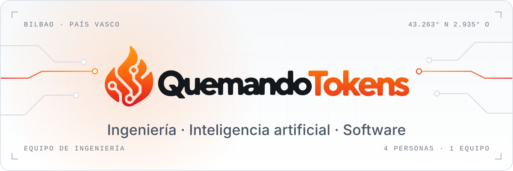
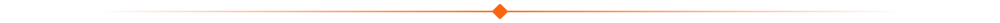
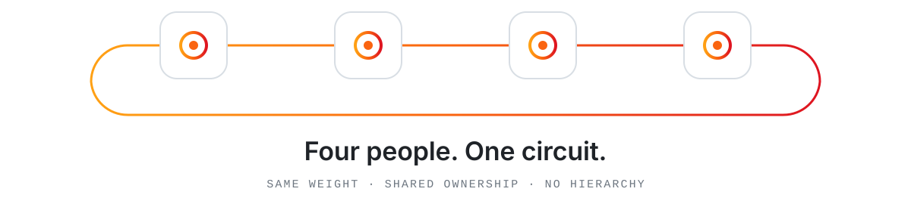
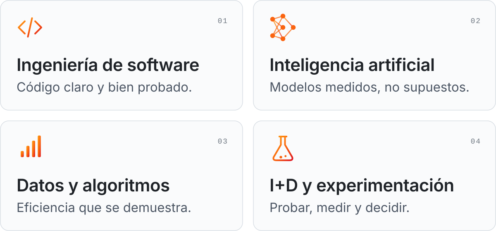
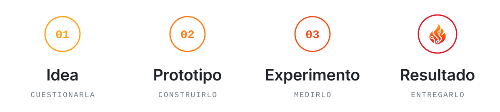
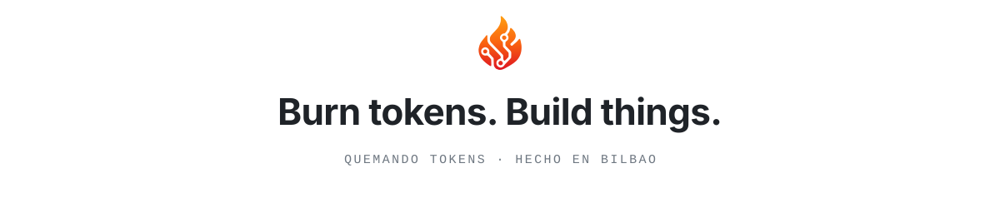

<!-- Quemando Tokens · perfil de la organización · recursos gráficos en ./assets -->

<div align="center">

<picture>
  <source media="(prefers-color-scheme: dark)" srcset="./assets/banner-dark.svg">
  <source media="(prefers-color-scheme: light)" srcset="./assets/banner-light.svg">
  
</picture>

<sub><a href="#quiénes-somos">Quiénes somos</a> &nbsp;·&nbsp; <a href="#el-equipo">El equipo</a> &nbsp;·&nbsp; <a href="#en-qué-trabajamos">En qué trabajamos</a> &nbsp;·&nbsp; <a href="#cómo-trabajamos">Cómo trabajamos</a> &nbsp;·&nbsp; <a href="#ahora">Ahora</a> &nbsp;·&nbsp; <a href="#proyectos">Proyectos</a></sub>

</div>

### Quiénes somos

**Cuatro estudiantes de ingeniería en Bilbao a quienes nos gustan los problemas difíciles.**

Estudiamos en la Universidad de Deusto y construimos juntos: software, inteligencia artificial y alguna idea que parece demasiado ambiciosa hasta que funciona. Nos importa hacer las cosas bien: código claro, resultados honestos y un trabajo que enseñaríamos con orgullo.

<details>
<summary><sub>¿Por qué «Quemando Tokens»?</sub></summary>
<br>

Porque así se avanza: quemando tokens, horas de cómputo y alguna que otra noche hasta que una idea se convierte en algo que funciona. La llama y el circuito del logotipo cuentan lo mismo: energía convertida en ingeniería.

</details>

<p align="center"></p>

### El equipo

<picture>
  <source media="(prefers-color-scheme: dark)" srcset="./assets/team-dark.svg">
  <source media="(prefers-color-scheme: light)" srcset="./assets/team-light.svg">
  
</picture>

Cuatro personas y un solo equipo. Sin cargos ni rangos: cada voz pesa lo mismo, cada proyecto se planifica, se construye y se revisa en común, y el mérito se reparte igual.

<p align="center"></p>

### En qué trabajamos

<picture>
  <source media="(prefers-color-scheme: dark)" srcset="./assets/focus-dark.svg">
  <source media="(prefers-color-scheme: light)" srcset="./assets/focus-light.svg">
  
</picture>

<p align="center"></p>

### Cómo trabajamos

<picture>
  <source media="(prefers-color-scheme: dark)" srcset="./assets/workflow-dark.svg">
  <source media="(prefers-color-scheme: light)" srcset="./assets/workflow-light.svg">
  
</picture>

- **Construir para entender.** Aprendemos más rápido cuando algo funciona de verdad.
- **Evidencias antes que opiniones.** Probamos, medimos y nos quedamos con lo que resiste.
- **Juntos por defecto.** Decisiones, revisiones y mérito compartidos.
- **Terminar lo que empezamos.** Una idea cuenta cuando funciona.

<p align="center"></p>

### Ahora

**NASA Space Apps Challenge 2026** · 14 y 15 de noviembre.<br>
Estamos preparando la forma de trabajar: metodología, revisión, pruebas y herramientas. El proyecto en sí empezará con el reto, como establecen las bases.

<p align="center"></p>

### Proyectos

```console
$ ls QuemandoTokenss/
# todavía no hay proyectos públicos: esta lista solo crecerá con trabajo real y funcional.
```

<!--
  Añadid aquí cada proyecto cuando sea público. Una línea por proyecto:

  | Proyecto | Qué hace | Tecnologías |
  | :-- | :-- | :-- |
  | [nombre](https://github.com/QuemandoTokenss/nombre) | Una frase clara. | Python · PyTorch |
-->

<p align="center"></p>

<picture>
  <source media="(prefers-color-scheme: dark)" srcset="./assets/footer-dark.svg">
  <source media="(prefers-color-scheme: light)" srcset="./assets/footer-light.svg">
  
</picture>

<p align="center"><sub>Equipo independiente de estudiantes. Sin afiliación oficial con la NASA ni con la Universidad de Deusto.</sub></p>
